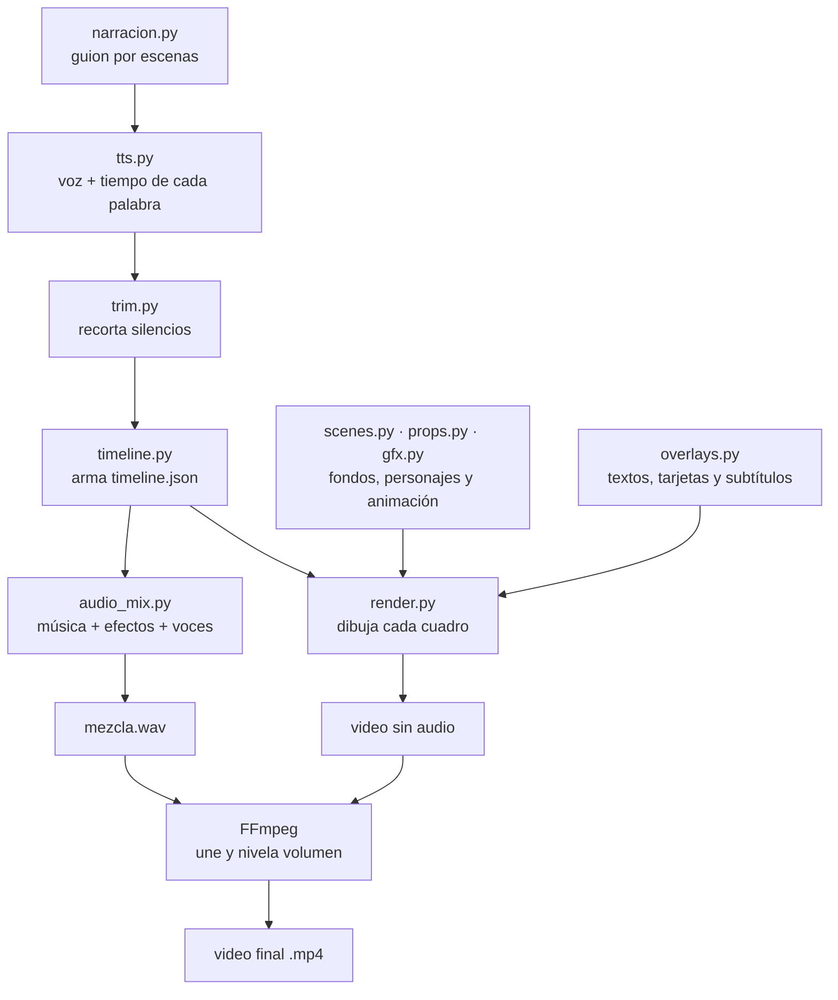

# Video Innovación


Un video animado vertical, en formato de reel, hecho **por completo con código**. No se usó ningún programa de edición ni de dibujo. Los personajes, los fondos, la animación, los textos, los subtítulos, la música y los efectos de sonido salen de scripts de Python. Las voces son voces sintéticas.

El video cuenta la historia de una cafetería donde puedes entrar con tu mascota y explica la tecnología que usa el negocio: app, kioscos, menús con QR, base de datos de clientes, pagos sin contacto e inventarios.

---

## Índice

- [Cómo funciona, en palabras sencillas](#cómo-funciona-en-palabras-sencillas)
- [Cómo se conecta todo](#cómo-se-conecta-todo)
- [Tecnologías usadas](#tecnologías-usadas)
- [Estructura del proyecto](#estructura-del-proyecto)
- [Requisitos](#requisitos)
- [Instalación](#instalación)
- [Uso](#uso)
- [Cómo cambiar el video](#cómo-cambiar-el-video)
- [Detalles técnicos](#detalles-técnicos)
- [Problemas comunes](#problemas-comunes)
- [Contribuir](#contribuir)
- [Licencia](#licencia)

---

## Cómo funciona, en palabras sencillas

Piensa en el proyecto como una pequeña fábrica con estaciones. Cada estación hace una parte y le pasa su resultado a la siguiente.

1. **El guion.** Todo empieza con un texto partido en escenas (`narracion.py`). Cada escena dice qué voz la lee.

2. **La voz.** Un script le manda cada escena a un servicio de voz sintética (Microsoft Edge TTS). Este servicio devuelve dos cosas: el audio y **el segundo exacto en que se dice cada palabra**. Ese dato es la pieza clave de todo el proyecto, porque con él se sincroniza todo lo demás.

3. **El recorte de silencios.** Las voces sintéticas dejan pausas largas entre oraciones. Un script las acorta a menos de medio segundo para que el video tenga el ritmo rápido de un reel, y ajusta los tiempos de cada palabra para que sigan cuadrando.

4. **La línea de tiempo.** Con la duración de cada audio se arma un "calendario" del video: cuándo empieza cada escena, cuándo se cambia de toma y en qué segundo suena cada palabra. Todo se guarda en `timeline.json`.

5. **Los dibujos.** Cada fondo y cada personaje se dibuja con figuras básicas: círculos, rectángulos, líneas y polígonos, con contorno negro y colores planos, como una caricatura. Se dibuja al doble de tamaño y luego se reduce para que los bordes salgan suaves.

6. **La animación.** Para cada cuadro del video (30 por segundo) el programa se pregunta "¿qué segundo es?" y con eso decide qué dibujar. Por ejemplo: la cámara se acerca poco a poco, el perro mueve la cola, los personajes parpadean y mueven la boca solo mientras su voz está diciendo una palabra, y un texto aparece con un pequeño rebote justo cuando la voz lo menciona.

7. **Los textos y subtítulos.** Encima del dibujo se ponen el nombre del lugar, tarjetas con datos (un reloj, un QR, una credencial, un medidor) y subtítulos que muestran 2 o 3 palabras a la vez, con la palabra que se está diciendo en amarillo.

8. **La música y los efectos.** No se descargó ningún audio. La música (un ritmo lo-fi y luego uno más alegre) y los efectos (un "pop", campanitas, notificaciones, tic-tac, un ladrido de caricatura) se generan con fórmulas matemáticas de ondas. La música baja sola cuando alguien habla.

9. **El render.** Los cuadros se dibujan en paralelo con varios núcleos del procesador y se van mandando a FFmpeg, que los convierte en video MP4.

10. **La unión final.** FFmpeg junta el video con la mezcla de audio y nivela el volumen al estándar de redes sociales (-14 LUFS).

---

## Cómo se conecta todo



La idea más importante: **los tiempos de las palabras mandan**. Si cambias una frase del guion, se vuelve a generar la voz, cambian los tiempos y todo lo demás (escenas, textos, subtítulos, bocas y efectos de sonido) se reacomoda solo.

---

## Tecnologías usadas

| Herramienta | Para qué se usa |
|---|---|
| **Python** | Lenguaje de todo el proyecto |
| **Pillow** | Dibujar los personajes, fondos, tarjetas y textos cuadro por cuadro |
| **NumPy** | Generar la música y los efectos con ondas, y mezclar el audio |
| **edge-tts** | Voces sintéticas en español y el tiempo de cada palabra |
| **imageio-ffmpeg** | Trae FFmpeg para codificar el video y unirlo con el audio |
| **multiprocessing** | Dibujar muchos cuadros al mismo tiempo con varios núcleos |
| **Segoe UI** | Tipografía de los textos (viene con Windows) |

---

## Estructura del proyecto

```
video-inovacion/
├── README.md
├── LICENSE
├── requirements.txt
└── motor/
    ├── narracion.py   # Guion: texto de cada escena y qué voz lo dice
    ├── tts.py         # Genera las voces y los tiempos de cada palabra
    ├── trim.py        # Recorta los silencios largos
    ├── timeline.py    # Arma la línea de tiempo (escenas, tomas, palabras)
    ├── gfx.py         # Lienzo de dibujo y personaje principal
    ├── props.py       # Mascotas, equipo, utilería, fondos y tarjetas
    ├── scenes.py      # Cada toma: fondo, animación y textos
    ├── overlays.py    # Etiquetas, chips, subtítulos, logo y créditos
    ├── audio_mix.py   # Música, efectos y mezcla con las voces
    ├── render.py      # Dibuja los cuadros y arma el MP4
    └── logo.png       # Logo que sale en el video
```

Al correrlo se crean carpetas de trabajo que no se suben al repositorio: `motor/audio/`, `preview/`, `segs/`, además de `mezcla.wav` y los videos.

---

## Requisitos

- Python 3.10 o más reciente
- Windows (para la fuente Segoe UI; en otro sistema hay que cambiar las rutas de fuentes en `gfx.py`)
- Conexión a internet, solo para generar las voces
- Unos 2 GB libres para los archivos temporales del render

---

## Instalación

```bash
git clone <url-de-este-repositorio>
cd video-inovacion
pip install -r requirements.txt
```

---

## Uso

Todos los comandos se corren dentro de la carpeta `motor/`.

```bash
cd motor

# 1. Generar las voces (la voz por defecto y la velocidad)
python tts.py es-MX-JorgeNeural "+12%"

# 2. Recortar silencios
python trim.py

# 3. Armar la línea de tiempo (imprime cuánto dura cada toma)
python timeline.py

# 4. (Opcional) Ver cuadros de prueba en preview/sheet.png
python render.py stills 5 20 40 60 80 100

# 5. Generar la música, los efectos y la mezcla
python audio_mix.py mezcla.wav

# 6. Dibujar todo el video (usa 12 núcleos; se cambia con la variable JOBS)
python render.py video

# 7. Unir video y audio
python render.py mux ../video_final.mp4 mezcla.wav
```

El render completo tarda unos pocos minutos en una computadora con varios núcleos.

---

## Cómo cambiar el video

| Quiero cambiar… | Archivo |
|---|---|
| Lo que dicen las voces | `narracion.py` (lista `PARTS`) |
| Qué voz dice cada parte | `narracion.py` (diccionario `VOICES`) |
| En qué palabra cambia la toma | `timeline.py` (lista `SCENES`) |
| Fondos, personajes y animación | `scenes.py` y `props.py` |
| Textos, tarjetas y créditos | `scenes.py` (método `overlay`) y `overlays.py` |
| Música y efectos de sonido | `audio_mix.py` (función `main`) |

Después de cambiar el guion hay que volver a correr los pasos 1 a 3, y después el 5 al 7.

Para ver las voces disponibles en español:

```bash
python -m edge_tts --list-voices | findstr es-
```

---

## Detalles técnicos

- **Formato:** MP4 H.264, 1080×1920, 30 fps, audio AAC estéreo a 44.1 kHz.
- **Dibujo suave:** todo se dibuja al doble de resolución y se reduce con filtro Lanczos.
- **Margen para la cámara:** los fondos se dibujan 8% más grandes que el cuadro para poder acercar la cámara sin perder nitidez.
- **Zonas del cuadro:** nombre del lugar arriba, datos en el centro, personajes abajo, subtítulos en la altura 1470 y nada de texto debajo de 1536 px, donde las redes ponen sus botones.
- **Bocas sincronizadas:** un personaje abre la boca solo durante los intervalos en que su voz está diciendo una palabra.
- **Ducking:** el volumen de la música se calcula con el promedio móvil de la voz (con sumas acumuladas para que sea rápido) y baja cuando alguien habla.
- **Volumen final:** filtro `loudnorm` de FFmpeg a -14 LUFS.
- **Caché:** los dibujos que se repiten (personajes con la misma pose, tarjetas) se guardan en memoria para no redibujarlos en cada cuadro.

---

## Problemas comunes

| Problema | Solución |
|---|---|
| `tts.py` falla | Revisa tu conexión a internet; el servicio de voz es en línea |
| Error de fuente no encontrada | Estás fuera de Windows: cambia `FONT_DIR` y `FONTS` en `gfx.py` |
| `KeyError` con una palabra | Cambiaste el guion y una escena busca una palabra que ya no existe: actualízala en `scenes.py` o `audio_mix.py` |
| Textos encimados | Revisa las coordenadas en el método `overlay` de esa toma |
| El render se queda sin memoria | Baja los núcleos con la variable `JOBS`, por ejemplo `JOBS=4` |

---

## Contribuir

1. Haz un fork del repositorio.
2. Crea una rama: `git checkout -b mi-cambio`.
3. Haz tus cambios y genera unos cuadros de prueba con `render.py stills` para revisarlos.
4. Haz commit y abre un pull request explicando qué cambiaste.

---

## Licencia

Este proyecto está bajo la licencia MIT. Consulta el archivo [LICENSE](LICENSE).
